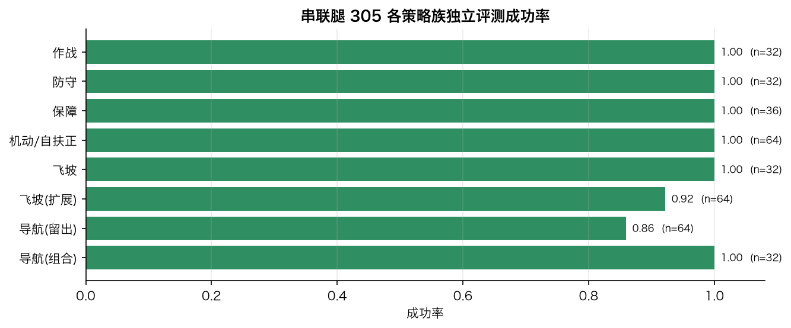

[English](README.en.md) | **中文**

# Arena-RL

基于 [Arena-1](https://github.com/RM-Arena/Arena-1) 的强化学习训练库。复用 Arena 的 Rust 物理、规则、回放，以及 `ArenaEnv` / `VectorArena` 并行环境，不维护另一套模拟器。

**整队版本（0.6）**：顶层 LLM 为 2027 全队每台机器人选择高层目标（打前哨、守家、追击敌方重型/英雄、占堡垒、夺中央卡、推家、补给……），Harness 负责规则状态、可行性过滤和指令编译；低层由一套对 15 个 2027 地面型号通用、按机器人参数条件化的 PPO 策略执行，空中机库使用学习的俯冲时机策略。检查点位于 `checkpoints/ground`，说明、训练命令、Mac/CUDA 资源利用和评测见[整队 LLM + 通用 RL](docs/zh/multi-robot.md)。

```bash
uv run arena-rl team-match --policies checkpoints/ground --commander llm --matches 2 --output runs/team-llm
uv run arena-rl serve-team --policies checkpoints/ground --realtime   # 外部 LLM 客户端通过 JSONL 指挥整队
sh examples/train_ground_all.sh runs/ground-v1 8 auto                  # 本机重新训练全部地面策略族
```

<p align="center"></p>

| 一局完整对局：LLM 指挥 + RL 执行（红方胜） | LLM 对每台红方机器人的指令时间线 |
| --- | --- |
|  |  |
| **通用策略 vs 专家 vs 随机（独立种子评测）** | **15 个型号的训练曲线** |
|  |  |
| **每型号评测热力图** | **Mac 本机训练吞吐优化** |
|  |  |

图表均由仓库内的检查点、评测报告和对局记录生成（`uv run --with matplotlib python examples/make_figures.py`），解读和限制见[整队文档](docs/zh/multi-robot.md)。

单机器人版本的 LLM 对局使用 **2027 串联腿步兵 305，红方槽位 3**，检查点位于 `checkpoints/serial305`，支持低血量撤退和物理自扶正后的恢复。见[305 训练与接口说明](docs/zh/serial305.md)。旧 W3 检查点保留为复现实验。

第一版选择 **2027 赛季 W3 双轮足步兵，型号 3，槽位 3**。每个进程只训练一台红方机器人；蓝方机器人按场景脚本运行。训练使用真实 PPO 更新网络权重。

## 安装

需要 Python 3.10+、Rust/Cargo 和两个相邻的源码目录：

```text
workspace/
  RMUC-Arena/    # Arena-1 源码，需包含并行环境和训练场景接口
  Arena-RL/
```

```bash
cd ../RMUC-Arena
cargo build --release --manifest-path simulation/Cargo.toml
cd ../Arena-RL
uv sync --locked --extra dev
uv run arena-rl --arena-root ../RMUC-Arena doctor
```

也可以用 `ARENA_ROOT=/absolute/path/to/RMUC-Arena` 指定模拟器。`doctor` 会检查需要的接口并显示源码与二进制指纹。Arena 的完整前端和桌面程序不是训练依赖。

**当前开发依赖**：需要 Arena 中的 `rmuc_arena/env.py`、`vector_env.py` 和 `simulation/src/training_scenario.rs`。如果下载的 Arena 版本缺少这些文件，需要使用包含这批改动的源码版本。训练元数据会记录实际 Git 提交、工作区是否有改动、关键源文件 SHA256、二进制 SHA256 和每回合的规则/引擎哈希。无法满足接口时直接报错，不会退回另一个物理实现。

## 训练低层技能

```bash
uv run arena-rl train --task move --steps 32768 --envs 4 --output runs/w3/move
uv run arena-rl train --task ramp --steps 32768 --envs 4 --output runs/w3/ramp
uv run arena-rl train --task outpost --steps 32768 --envs 4 --output runs/w3/outpost
uv run arena-rl train --task defend --steps 32768 --envs 4 --output runs/w3/defend
```

低层决策频率 **10 Hz（模拟时间）**；计算速度可以快于实时。动作由移动方向、瞄准偏移、俯仰偏移、开火、腿长和跳跃组成。学习器只能控制自己的槽位。

| 技能 | 初始课程 | 成功条件 |
| --- | --- | --- |
| `move` | 开阔区内随机出生点和目标点 | 进入 0.35 m 目标范围，速度低于 0.8 m/s |
| `ramp` | 真实 2027 地图的红方 15° 公路坡道，出生点有横向扰动 | 从低端越过坡顶，升高超过 0.12 m，到达坡后平台且保持直立 |
| `outpost` | 从敌方前哨附近开始，200 发训练弹量 | 对真实前哨装甲累计造成至少 40 点伤害 |
| `defend` | 基地入口附近，一台脚本控制的步兵持续接近 | 对入侵者累计造成至少 40 点伤害 |

**瞄准辅助是显式的**：射击技能使用 Arena SDK 提供的弹道瞄准，PPO 学习移动、瞄准修正、开火时机和轮足动作。第一版没有从原始图像或原始云台指令开始学习完整感知与瞄准；也不训练电机电流或关节力矩。过坡任务不要求腾空，不能把成功率解读成飞跃特技成功率。

`outpost` / `defend` 是短距离、低伤害阈值的入门课程，目标是验证训练链路。它们不代表已能摧毁整座前哨、消灭完整入侵队伍或赢得完整比赛。奖励和课程定义集中在 `src/arena_rl/tasks.py`，可以逐步提高距离、伤害目标和干扰强度。

## 高层决策

```bash
uv run arena-rl train-high --skills runs/w3 --steps 4096 --envs 4 --output runs/w3/manager
uv run arena-rl evaluate-high --checkpoint runs/w3/manager --episodes 32 --output runs/w3/manager/evaluation.json
```

管理策略每 **1 秒模拟时间** 选择 `outpost`（进攻）或 `defend`（守家）。它在同一回合中调用冻结的低层模型，最多执行 10 次低层动作；任务成功、机器人失效或入侵越界可提前结束。低层模型的权重和摘要会在训练前后核对。

第一版高层课程包含“前哨附近进攻”和“基地入口拦截”两种局部场景，场景种类不会直接进入模型输入。高层通过本机状态和合法视觉观测作决策；奖励来自实际伤害、存活和入侵越界，没有直接奖励某个正确选项标签。敌人行为独立于所选技能。场景较简单，完整地图长距离调度和突然出现的新威胁属于后续课程。

## 评测、回放和继续训练

```bash
uv run arena-rl evaluate --checkpoint runs/w3/move --episodes 32 --seed 1000000 --output runs/w3/move/evaluation.json --replays runs/w3/move/replays
uv run arena-rl evaluate --task move --baseline random --episodes 32 --seed 1000000
uv run arena-rl train --task move --steps 32768 --envs 4 --resume runs/w3/move --output runs/w3/move-continued
uv run arena-rl suite --config configs/w3.json --output runs/full
```

评测使用独立种子，训练默认从 7 开始，低层评测默认从 1,000,000 开始，高层默认从 2,000,000 开始。`suite` 在相同评测种子上比较随机策略与训练策略；低层技能完全没有评测成功时停止高层训练。

每个训练目录包含 `policy.zip`（权重与优化器）、`metadata.json`（版本和训练证据）、`metrics.jsonl`（学习过程）。继续训练恢复网络和优化器，从新的回合开始，不承诺逐比特恢复中断瞬间的采样器状态。默认拒绝加载与模拟器源码及内嵌引擎/规则哈希不匹配的检查点（同源码的不同平台构建可兼容）；只有显式指定 `--allow-engine-change` 才允许低层继续训练或评测时更换模拟器。PyTorch 检查点仅加载自己生成或可信来源的文件。

回放采用 Arena 原生 v4 格式，保留训练出生点、弹量和完整动作，可直接用 Arena 回放页面导入：

```bash
cd ../RMUC-Arena
uv run rmuc-arena replay verify ../Arena-RL/runs/w3/move/replays/move-1000000.json
```

Gymnasium 接口可从 `arena_rl.envs.SingleRobotEnv` 使用；SB3 适配器 `SkillVecEnv` 使用 Arena 的持久并行进程，不再额外包一层 SB3 子进程。环境区分成功/失败结束与时间截断，保留终止观测，再为 SB3 自动重置。

## 测试

```bash
uv run pytest -q
```

覆盖 Gymnasium 合约、动作归属、并行进程隔离、固定种子复现、真实坡道和伤害、回放验证、网络权重更新、摘要校验和冻结技能的高层训练。

实现依据：[Gymnasium Env 接口](https://gymnasium.farama.org/api/env/)、[SB3 PPO](https://stable-baselines3.readthedocs.io/en/master/modules/ppo.html)。项目遵循随仓库提供的非商业学习许可证；Arena 和训练依赖各自保留其许可。

## 已跑通的参考模型

见 [第一轮训练记录](docs/zh/first-training.md) 和 [参考检查点](checkpoints/w3)。四项低层技能各 32 个独立场景均完成；高层为 31/32。记录同时公布随机基线：短距离、辅助瞄准的射击课程本来就很容易，暂不能据此宣称训练出了更强的实战射击能力。

## LLM 顶层指令与 RL 执行

新增[战术接口](docs/zh/llm-tactics.md)：支持导航、指定建筑攻击、指定机器人接战/追击、区域防守、补给、护送、巡逻、专用飞坡，以及 305 的撤退和恢复。顶层 LLM 通过带参数的 JSON 指令调度，低层 PPO 按 10 Hz 持续执行；换令保留同一模拟进程、位置和弹量。支持显式目标锁定、短时目标记忆、追击边界、指令时效校验和执行反馈。

```bash
uv run arena-rl serve-tactics --policies checkpoints/tactics --realtime --record
uv run arena-rl mission --policies checkpoints/tactics --output runs/continuous-mission
```

通用服务由外部客户端提供 LLM 推理；仓库另提供 `llm-matches`，按显式命令调用 DeepSeek 付费 API。旧版二选一 PPO 高层仍可作为对照。


## W3 历史评测：补给、护送、巡逻和飞坡

`checkpoints/tactics` 现含五组策略。补给、护送、巡逻共用 2027 `support` 策略；专用飞坡使用 2026 `flight` 策略，包含真实 650 mm 间隙的正向跨越、返程跳跃和落地稳定。2027 地图没有这个专用飞坡，服务通过 `--season 2026` 选择对应地图。

```bash
uv run arena-rl train-tactics --family support --steps 32768 --envs 4 --output runs/support
uv run arena-rl train-tactics --family flight --steps 16384 --envs 4 --output runs/flight
uv run arena-rl serve-tactics --policies checkpoints/tactics --season 2026 --realtime --record
```

补给使用真实购买、扣款和补给区回血；护送只控制本机，目标队友由比赛宿主控制；巡逻按顺序完成全部点位和停留时间。飞坡先用成功示范初始化，再做 PPO 更新，部署时不使用示范脚本替代策略。具体命令、适用范围和训练记录见[战术接口](docs/zh/llm-tactics.md)与[扩展评测](docs/zh/extended-results.md)。原来失败的两个导航场景也已修复，完整导航回归为 32/32。

## 接入顶层 LLM

现提供真实的 DeepSeek V4.1 Flash 顶层调度：函数调用选择技能，冻结的 PPO 策略只执行红方槽位 3。LLM 请求异步运行，等待期间继续当前技能；超时或非法输出会保留当前执行并记录错误。使用现有 shell 中的 `DEEPSEEK_API_KEY`（也兼容 `DeepSeek_API_Key`）：

```bash
uv run arena-rl llm-matches --policies checkpoints/serial305 --matches 3 --max-calls 150 --output runs/serial305-full
```

默认并行运行三场正常 420 秒的 2027 对局，对手为明确标记的脚本英雄和步兵，红方只有一台 305。它验证真实 LLM 调度、技能切换与完整对局链路；这不是标准满编队伍比赛。决策日志、推理延迟、失败原因、比赛结果和原生回放均保存。参数、权限边界和记录解释见 [LLM 接入说明](docs/zh/llm-agent.md)与[早期 W3 对局记录](docs/zh/llm-match-results.md)。


当前 305 的权重、撤退/恢复课程、安全坐标接口及完整对局记录见[训练说明](docs/zh/serial305.md)和[评测结果](docs/zh/serial305-results.md)。旧版 W3 的 32/32 导航成绩不适用于 305；当前模型的限制单独报告。

0.5.1 修复版的导航/飞坡原始回归均为 32/32，并完成同一进程内的正向、返程和 420 秒 2026 对局验证。扩大扰动测试的限制及新的真实 LLM 对局见[修复评测](docs/zh/serial305-refinement-results.md)。



## 文档

每篇文档都有中英文两个版本，页首可切换。

| 文档 | 内容 |
| --- | --- |
| [整队 LLM + 通用 RL](docs/zh/multi-robot.md) | 0.6：全队 LLM 指挥、Harness、15 个地面型号的通用策略、空中俯冲策略、Mac/CUDA 训练、评测与整队对局 |
| [305 训练与接口](docs/zh/serial305.md) | 串联腿 305 的撤退、自扶正恢复和安全坐标接口 |
| [305 修复评测 0.5.1](docs/zh/serial305-refinement-results.md) / [305 评测 0.5.0](docs/zh/serial305-results.md) | 305 的回归、扩大测试和真实 LLM 对局 |
| [LLM 战术接口](docs/zh/llm-tactics.md) | 单机器人参数化战术指令与 RL 执行 |
| [LLM 接入说明](docs/zh/llm-agent.md) / [W3 对局记录](docs/zh/llm-match-results.md) | DeepSeek 战术规划器、完整对局运行器和早期结果 |
| [战术执行验证](docs/zh/tactical-results.md) / [扩展评测](docs/zh/extended-results.md) | W3 战术策略、补给/护送/巡逻/飞坡评测 |
| [第一轮训练记录](docs/zh/first-training.md) | W3 低层技能和高层管理策略的首次训练 |
| [边界与扩展点](docs/zh/architecture.md) | 与 Arena 的边界、并行环境和扩展方式 |
