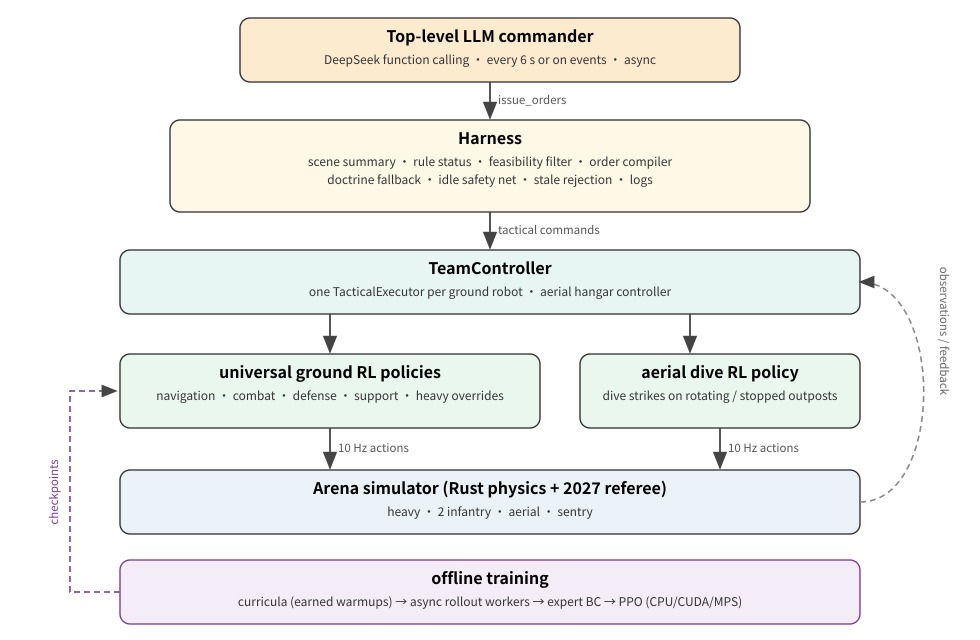
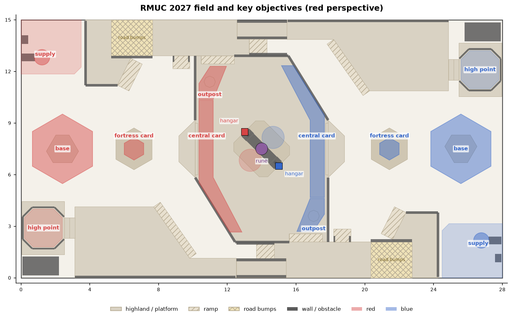
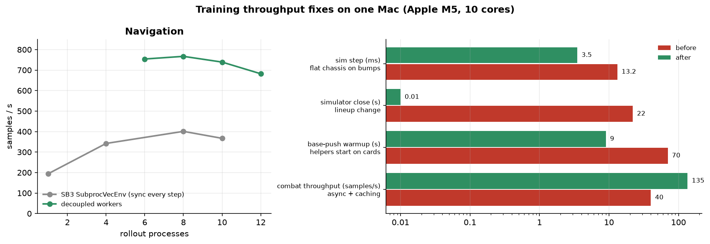
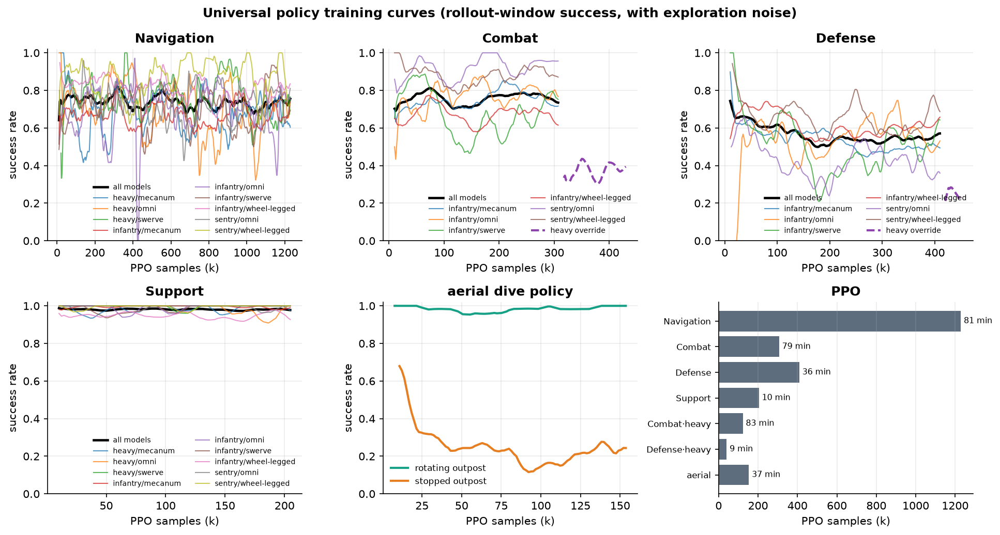
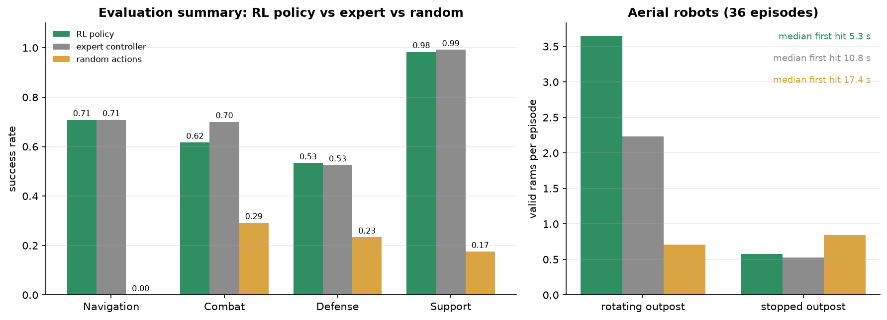
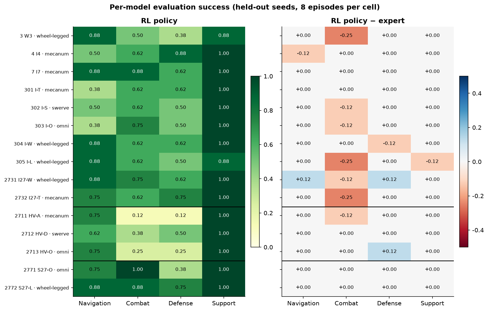
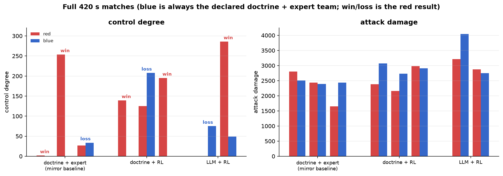
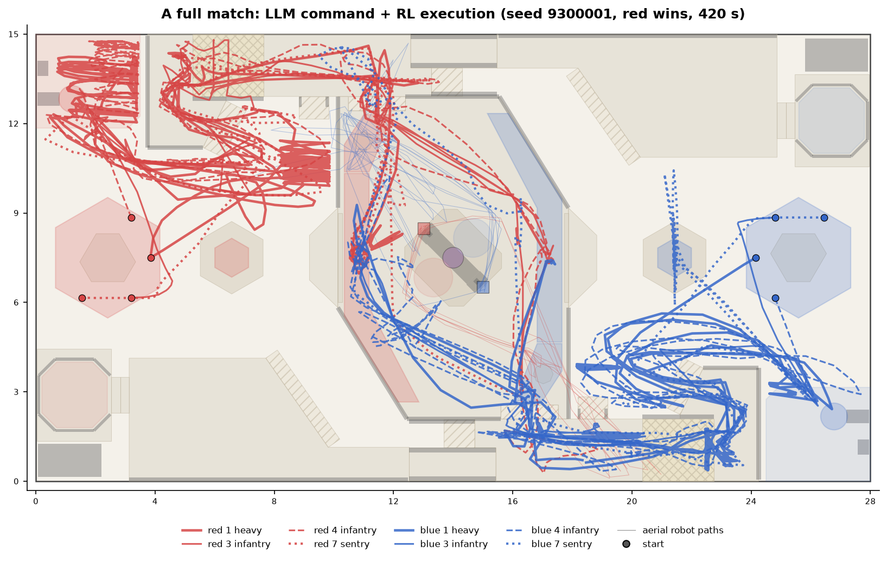
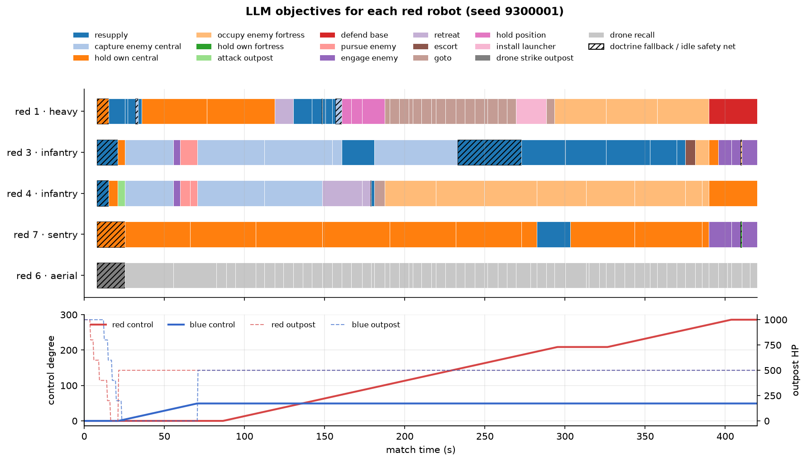

**English** | [中文](zh/multi-robot.md)

# Team LLM command + universal RL execution (every 2027 robot type)

This release extends the single-robot 305 "LLM tactics + RL execution" setup to an **entire 2027 team**: at each decision the top-level LLM selects one high-level objective for every robot (attack the outpost, defend base, pursue the enemy hero/heavy, occupy the fortress, push base, ...); the Harness handles feasibility checks, rule state and order compilation; and at the low level **a single PPO policy, universal across all ground models and conditioned on robot parameters,** executes at 10 Hz. Physics, rules and the referee all come from the original Arena; the simulator was not modified.



## Robot coverage

| Slot | Robot type | Selectable models (2027-legal) | Chassis | Low-level execution |
| --- | --- | --- | --- | --- |
| 1 | Heavy (hero + engineer merged) | 2711 / 2712 / 2713 | Mecanum / swerve / omni | Universal policy; the 42 mm launcher must first be unlocked and then installed at the workbench (`install_launcher`) |
| 3, 4 | Infantry | 3, 4, 7, 301–305, 2731, 2732 | Wheel-legged / mecanum / swerve / omni | Universal policy |
| 7 | Sentry | 2771 / 2772 | Omni / serial-leg | Universal policy (stance switched by the host per phase) |
| 6 | Aerial robot system | 2761 / 2762 / 2763 | Hangar + 2–4 aircraft | Outpost strike: learned dive-timing policy (independent per aircraft); base strike: explicit guidance; routes around the central rune gantry |

One policy covers 15 ground models. The observation includes public design parameters (robot type, chassis, caliber, dimensions, jump/self-righting/tunnel capability, reference speed, mass, gimbal angular rate), and the same 7-dimensional discrete action is interpreted according to the chassis:

| Action head | Wheel-legged (non-omni) | Mecanum/swerve/omni |
| --- | --- | --- |
| Movement mode + speed | Along route/backward/sideways; turn first, then translate | Translate in any direction |
| Pitch/yaw residual, fire | SDK ballistic assist + learned residual | Same as left |
| Stance | Leg length low/standard/high | Normal / spin (yaw_rate) / supercapacitor boost |
| Evasion | Jump (navigation only) | Alternating lateral dodge |

The old 305-specific policy bank (`checkpoints/serial305`, including self-righting and the 2026 fly-slope) is unchanged, and the old interfaces and tests still work as before.

## Training scenarios (real mechanics, no referee state edits)

Training scenarios set only spawn poses and ammunition; structure damage, point capture, opening the base armor and launcher installation are all genuinely obtained through ordinary actions during warmup:

- **Navigation**: random routes between map landmarks and navigation nodes, three consecutive order changes (within the same episode), and retreat to the supply zone; timeouts are computed from the public grid route length.
- **Combat**: attack the outpost (optionally with a return-firing guard), engage/pursue (targets include the enemy heavy, fleeing or circling, some returning fire), and **push base** (a helper first occupies the enemy central highland card to take the outpost control point; after 180 s another helper occupies the enemy fortress card for 10 s to open the base armor; then the learner shoots the base).
- **Defense**: defend base (1–2 intruders, some firing), hold own central card, capture enemy central card, **occupy enemy fortress** (after 180 s and while controlling the enemy outpost point, holding the card for 10 s opens the base armor, which counts as success), and **hold own fortress** (the enemy first captures our outpost point so that our fortress becomes active).
- **Support**: caliber-specific resupply (17 mm / 42 mm), escort, patrol.
- **Heavy**: first genuinely waits for the launcher to unlock and installs it; a blue helper occupies our central card so that our control degree falls behind, which under the public formula unlocks it at about 185 s (otherwise 300 s); after that the expert controller drives the transit, and several recorded phases run back to back within the same episode to amortize the warmup cost.



The figure above is drawn directly from Arena's 2027 map geometry and marks the named places used in training and in LLM orders. The road bumps (cross-hatched) are a physics computation hotspot for flat chassis; see the next section.

## Local (Mac) resource utilization

Measurements and the corresponding designs:

- **Decoupled, asynchronous rollout worker processes**: SB3 `SubprocVecEnv` synchronizes all environments at every 10 Hz step, so the slowest environment (path search, reset, warmup) holds up every process: going from 1→8 processes gave only 194→401 steps/s. `parallel.RolloutWorkers` gives each process its own simulator and a CPU copy of the policy, and each process collects complete rollout segments independently (about 750 steps/s with 8 processes; the M5's 10 cores saturate at 6–8 processes). In the combat curriculum, heavy warmup can make a single process take 185 s for one segment, so collection was further changed to asynchronous streaming: as soon as any process returns a segment, it is immediately dispatched the next one with the latest weights, and the learner updates on the first 8 segments to arrive; PPO absorbs 1–2 versions of lag through the behavior log-probabilities recorded at sampling time and its clipping.
- **Two training jobs in parallel**: even with asynchronous collection, a single job leaves cores idle (processes waiting on Rust or on startup); training two families at once fills all 10 cores and gives higher total throughput than running them serially.
- **Simulator lifecycle**: when the lineup changes, the old simulator is closed, and `Match.close` waits for the Rust process to exit, which takes about 20 s each time under load and once accounted for 88% of combat training time. Now each process caches up to 6 simulators keyed by lineup, and on eviction it terminates the process before closing.
- **Warmup cost**: push base / occupy enemy fortress first requires genuinely capturing the enemy central card, waiting until 180 s, and then occupying the fortress for 10 s. Helper robots are deployed directly on the cards (referee timing is still required), and pure waiting uses coarse-grained action repeat; push-base warmup dropped from 70 s of wall-clock time to about 9 s. The heavy launcher unlock time is shortened to about 185 s using the public formula (falling behind in control degree unlocks it earlier).
- **Learner device**: a PPO update of the small MLP takes 0.07 s on CPU and 2.3 s on MPS (startup and small-batch overhead), so `--device auto` selects CPU on a Mac, and CUDA when CUDA is available. Rollout worker processes always run inference on CPU with a single thread.
- **Physics hotspot**: wheel–ground contact computation for mecanum/omni/swerve chassis on road bumps is extremely slow (a single step for the swerve heavy can reach 268 ms, versus about 3 ms normally). Route planning sends flat chassis along the bump-free half of the road (wheel-legged chassis keep their existing perpendicular bump crossing), cutting the average simulation step time from 13.2 ms to about 3.5 ms.
- **Warmup acceleration**: during pure waiting phases (timers, waiting for unlock, timing on a card), action repeat is temporarily raised from 2 to 20 physics ticks; 60 s of simulation now takes 1.0 s instead of 2.1 s.
- **Expert demonstrations + PPO**: from a chassis-aware expert controller only successful episodes are kept for behavior cloning, followed by PPO fine-tuning, which avoids exploring the whole map from scratch.



## CUDA

```bash
uv run arena-rl train-ground --family combat --device cuda --workers auto --output runs/ground-cuda/combat
```

`--device cuda|cuda:N` places PPO updates and behavior cloning on the GPU, while rollout still runs in CPU processes; it automatically sets `CUBLAS_WORKSPACE_CONFIG` and enables deterministic algorithms (`warn_only`). The CUDA path has not been verified on this machine (it has no CUDA).

## Commands

```bash
# Train and evaluate all four universal policy families (navigation/combat/defense/support)
sh examples/train_ground_all.sh runs/ground-v1 8 auto
# Train a single family; evaluate per model
uv run arena-rl train-ground --family navigation --steps 1228800 --workers 8 --output runs/ground/navigation
uv run arena-rl evaluate-ground --checkpoint runs/ground/navigation --episodes-per-model 12
# When a group of models underperforms, fine-tune specifically, starting from the universal policy (a directory named <family>-<name> is automatically loaded by the policy bank as an override)
uv run arena-rl train-ground --family combat --models 2711 2712 2713 --initialize-from checkpoints/ground/combat \
  --steps 204800 --output checkpoints/ground/combat-heavy
# Full-team match: LLM command (DeepSeek, function calling) + RL execution; blue is the declared rule-based team
uv run arena-rl team-match --policies checkpoints/ground --commander llm --matches 2 --output runs/team-llm
# No-LLM baseline (same Harness, doctrine commander)
uv run arena-rl team-match --policies checkpoints/ground --commander doctrine --speed 0 --output runs/team-doctrine
# An external LLM client commands the whole team over JSONL
uv run arena-rl serve-team --policies checkpoints/ground --realtime
```

## LLM Harness

- **One strict tool**: `issue_orders(plan, orders)`, with one `{objective, target, place, intent}` entry per robot. Each robot's `objective` enum contains only the objectives executable at that moment; target robot IDs and named places are enums as well. Orders are revalidated at the current tick before being applied.
- **Scene summary**: time, score (control degree/damage/kills), structure HP and ownership, control points, rule state (whether the enemy base is protected / its armor is open, whether we control the enemy outpost point, whether the enemy fortress is available, whether our fortress is active, unlock time), economy, each robot's status and the execution feedback for its current order, feasible objectives and the reasons blocked objectives are blocked, enemies currently in team vision and recently seen, public events, and the last few decisions with their rejection reasons. Opponent ammunition, economy and strategy are not exposed.
- **Objectives**: `attack_outpost`, `push_base`, `defend_base`, `capture_enemy_central`, `hold_own_central`, `occupy_enemy_fortress`, `hold_own_fortress`, `pursue_enemy` (e.g., pursuing the enemy heavy/hero), `engage_enemy`, `resupply`, `retreat`, `escort`, `patrol`, `goto`, `hold_position`, `install_launcher`; aerial: `drone_strike_outpost`, `drone_strike_base`, `drone_recall`.
- **Asynchrony and fault tolerance**: robots keep executing their current orders during inference; timeouts, invalid output and stale decisions are logged, and the doctrine commander serves as the fallback; when a robot has been idle for 8 s without an order, doctrine issues a fill-in order; teammate vision is shared into every executor's target memory.
- **Logging**: each match's request scenes, model replies, application results, errors, latency and token usage are written to `decisions-<seed>.jsonl`, and native replays can be verified with Arena.
- **Switching models**: `--model`, `--base-url` and `--api-key-env` point to any OpenAI-compatible function-calling API (default: the DeepSeek strict-mode beta endpoint); the key is read only from the environment variable and never enters prompts or logs.

### `serve-team` JSONL protocol (external LLM / agent clients)

One JSON request per line, and one response line per request:

| Request | Purpose |
| --- | --- |
| `{"op":"scene"}` | Returns the scene summary and the strict `issue_orders` tool definition for this moment (can be handed directly to the client's model) |
| `{"op":"orders","plan":"...","orders":{...},"basis_tick":N}` | Validates against the scene enums, rejects stale decisions, then compiles and executes; returns each robot's execution/rejection reason |
| `{"op":"advance","steps":k}` | In step mode, advances k×0.1 s; with `--realtime`, the simulation runs continuously in the background at 10 Hz |
| `{"op":"reset","seed":s}` / `{"op":"save_replay","path":...}` / `{"op":"close"}` | Reset, export a native replay, close |

At startup, the first line, `ready`, contains the robot list and a recommended system prompt.

## Results

### Training volume (local Apple M5, CPU learner)

| Policy | Models covered | Demonstrations (samples from successful episodes) | Behavior cloning full-action agreement | PPO samples | Wall-clock |
| --- | --- | --- | --- | --- | --- |
| navigation | All 15 ground models | 31,637 | 0.89 | 1,228,800 | 81 min |
| combat | 10 infantry + 2 sentries | 16,842 | 0.89 | 307,200 | 79 min |
| combat-heavy (override) | 3 heavies | 2,565 | 0.82 | 122,880 | 83 min |
| defense | 10 infantry + 2 sentries | 52,616 | 0.94 | 409,600 | 36 min |
| defense-heavy (override) | 3 heavies | 27,049 | 0.92 | 40,960 | 9 min |
| support | All 15 ground models | 17,142 | 0.91 | 204,800 | 10 min |
| aerial | 3 hangar types | 27,573 | 0.97 | 153,600 | 37 min |

The heavies were diluted and degraded in mixed training (the swerve heavy's stochastic rollout success rate fell from 0.37 to 0.06), so combat/defense were changed to "infantry + sentry universal policy + heavy-specific override", with the policy bank selecting automatically by model.



The curves show rollout-window success rate with exploration noise (5-point moving average), not deterministic evaluation; see below for the evaluation.

### Per-model evaluation (independent seeds, 8 episodes per model per method, deterministic actions)

The "expert" is the chassis-aware rule-based controller that generated the demonstrations, and "random" is uniformly random actions; all three use the same seeds and the same simulator. Evaluation disables the training-only rule that "a flat chassis on a road bump fails immediately".

| Family | RL policy | Expert | Random |
| --- | --- | --- | --- |
| Navigation | 0.71 | 0.71 | 0.00 |
| Combat (with heavy override) | 0.62 | 0.70 | 0.29 |
| Defense (with heavy override) | 0.53 | 0.53 | 0.23 |
| Support | 0.98 | 0.99 | 0.17 |



| Model | Chassis | Navigation policy/expert | Combat policy/expert | Defense policy/expert | Support policy/expert |
| --- | --- | --- | --- | --- | --- |
| 3 Infantry W3 | Wheel-legged | 0.88 / 0.88 | 0.50 / 0.75 | 0.38 / 0.38 | 0.88 / 0.88 |
| 4 Infantry I4 | Mecanum | 0.50 / 0.62 | 0.62 / 0.62 | 0.88 / 0.88 | 1.00 / 1.00 |
| 7 Infantry I7 | Mecanum | 0.88 / 0.88 | 0.88 / 0.88 | 0.62 / 0.62 | 1.00 / 1.00 |
| 301 Infantry I-T | Mecanum | 0.38 / 0.38 | 0.62 / 0.62 | 0.62 / 0.62 | 1.00 / 1.00 |
| 302 Infantry I-S | Swerve | 0.50 / 0.50 | 0.62 / 0.75 | 0.50 / 0.50 | 1.00 / 1.00 |
| 303 Infantry I-O | Omni | 0.38 / 0.38 | 0.75 / 0.88 | 0.50 / 0.50 | 1.00 / 1.00 |
| 304 Infantry I-W | Wheel-legged | 0.88 / 0.88 | 0.62 / 0.62 | 0.62 / 0.75 | 1.00 / 1.00 |
| 305 Infantry I-L | Wheel-legged (serial-leg) | 0.88 / 0.88 | 0.62 / 0.88 | 0.50 / 0.50 | 0.88 / 1.00 |
| 2711 Heavy HV-A | Mecanum | 0.75 / 0.75 | 0.12 / 0.25 | 0.12 / 0.12 | 1.00 / 1.00 |
| 2712 Heavy HV-D | Swerve | 0.62 / 0.62 | 0.38 / 0.38 | 0.50 / 0.50 | 1.00 / 1.00 |
| 2713 Heavy HV-O | Omni | 0.75 / 0.75 | 0.25 / 0.25 | 0.25 / 0.12 | 1.00 / 1.00 |
| 2731 Infantry I27-W | Wheel-legged | 0.88 / 0.75 | 0.75 / 0.88 | 0.62 / 0.50 | 1.00 / 1.00 |
| 2732 Infantry I27-T | Mecanum | 0.75 / 0.75 | 0.62 / 0.88 | 0.75 / 0.75 | 1.00 / 1.00 |
| 2771 Sentry S27-O | Omni | 0.75 / 0.75 | 1.00 / 1.00 | 0.38 / 0.38 | 1.00 / 1.00 |
| 2772 Sentry S27-L | Wheel-legged (serial-leg) | 0.88 / 0.88 | 0.88 / 0.88 | 0.75 / 0.75 | 1.00 / 1.00 |

Each cell has only 8 episodes, so the error of a single cell is about ±0.17. Combat was additionally rechecked on 4 models × 10 identical seeds: behavior cloning 0.70, PPO 0.70, expert 0.725; the differences are within noise.



| Aerial (36 episodes) | Mean effective strikes | Mean damage | Episodes with a hit | Median time to first hit |
| --- | --- | --- | --- | --- |
| RL policy | **2.03** | 406 | 21 | **5.3 s** |
| Guidance expert | 1.33 | 267 | 18 | 10.8 s |
| Random | 0.78 | 156 | 18 | 17.4 s |

Conclusions:

- Across the 15 models, the ground policies generally reach the level of the expert that generated the demonstrations, but at the current budget **PPO fine-tuning does not significantly exceed the expert** (navigation, defense and support are on par; combat is slightly lower, within noise). The performance ceiling is set mainly by route planning and physical conditions: the flat-chassis omni/transforming infantry (301/303) still reach only 0.38 in navigation, and their failures are mostly timeouts and getting stuck.
- The hangar's dive-timing policy is the only part that clearly beats the rule-based controller: +52% hits, and the first hit arrives in half the time. Against the outpost after it stops rotating, it remains weak (0.58 valid rams per episode).
- Heavy combat/defense success rates are low (the expert is equally low): the 42 mm heat limit, the low-power chassis and the relatively short order time limit make it hard to finish within a single order; the heavy's main value lies in late-game base pushes after the launcher is installed.

### Full-team matches

These are complete 420 s 2027 matches; both sides use the default lineup (2711 heavy, 2731 / 2732 infantry, 2761 hangar, 2771 sentry), with normal economy, respawns and referee. Blue is always the declared rule-based team (doctrine command + expert controllers). All three groups use the same seeds, starting from 9300000; all native replays pass Arena verification.

| Red | Matches | Red wins | Red control degree | Red attack damage | Notes |
| --- | --- | --- | --- | --- | --- |
| doctrine + expert controllers (mirror baseline) | 3 | 2 | 1.7 / 253.6 / 27.0 | 2805 / 2435 / 1650 | Both sides' structures were destroyed by aerial strikes and then rebuilt |
| doctrine + RL execution | 3 | 2 | 139.2 / 125.2 / 195.2 | 2380 / 2160 / 2980 | In all three matches the heavy genuinely completed launcher installation |
| **DeepSeek LLM + RL execution** | 2 | 1 | 0.0 / 285.8 | 3215 / 2870 | 79–80 decisions per match, median latency 2.0 s (p95 2.6 s) |



LLM match details: each call uses about 5.2k prompt + 0.27k output tokens, about 430k tokens per match; there were 2 failures per match (the model produced invalid JSON or the network timed out), all handled by the doctrine fallback without interrupting the match. The model's most frequent objectives were, in order, capturing the enemy central card, recalling the aerial robot, occupying the enemy fortress, resupply and holding the own central card; 6 orders were rejected by the Harness (e.g., the outpost had already been destroyed during inference, the robot was already dead, or `goto` was given no place). The reports, LLM decision logs and downsampled trajectories for all three groups are stored in [`evaluations/team-matches-2026-10-19`](../evaluations/team-matches-2026-10-19).

The sample is very small (2–3 matches): it only shows that the pipeline works in real full matches and that LLM command performs at the same level as doctrine command; it does not support a claim that the LLM is stronger. In the first match the LLM lost on control degree: it kept both infantry and the sentry near the enemy central card for long stretches and did not hold its own outpost point.

Below is the second match, which the LLM won (seed 9300001). According to the decision log: the red heavy resupplied and held the own central card for the first 2 minutes, installed the launcher at 270 s and then moved on to occupy the enemy fortress, returning to defend the base in the last 30 s; both infantry contested the enemy central card during the first half, and infantry 4 occupied the enemy fortress continuously from 187 s onward; the sentry mostly held the own central card; the aerial robot was sent by doctrine to strike the outpost at 8 s and was kept recalled by the LLM from 25 s onward. In the trajectory plot, thick lines are ground robots and thin lines are aerial robot flight paths.



The timeline expands, from the LLM's `issue_orders` results, the objective in effect for each red robot at each moment; hatched blocks are doctrine fallback or idle fill-in orders, and below are both sides' control degree and outpost HP.



All figures are generated from data in the repository: `uv run --with matplotlib python examples/make_figures.py` (requires `ARENA_ROOT` to point to Arena so the map geometry can be read). Trajectories are downsampled from native replays by `examples/extract_match_traces.py` (one frame every 0.5 s).

## Limitations

- At this budget, PPO fine-tuning of the ground policies does not significantly exceed the expert; the gains come mainly from the universal contract itself (one network covering 15 models) and the engineered training infrastructure. Heavy combat/defense success rates are low.
- The hangar's learned policy is trained only for outpost strikes (rotating and stopped); base strikes still use explicit guidance. Heavy assembly (picking and placing energy units with the robotic arm) is not included; the launcher unlocks according to the time rule.
- The opponent is a declared rule-based team (doctrine + expert controllers), not self-play or a human team; win rates only reflect results against this opponent.
- During training each simulator has only one learner and the remaining robots are scripted; multi-robot coordination is done by the LLM/doctrine at the objective level.
