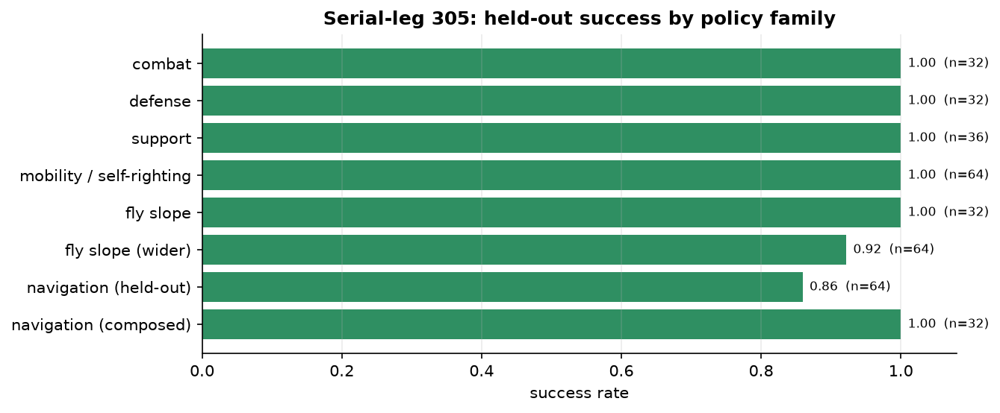

**English** | [中文](zh/serial305-refinement-results.md)

# 305 navigation and fly-slope fix record: 0.5.1

This update controls only red-3, the serial-leg 305, and reuses the original Rust simulator. Arena-RL was a private repository when this was recorded (public since 2026-10-19); Arena-1 was not committed or pushed. This record continues the [0.5.0 results](serial305-results.md).

## Fixes and training

Navigation adds a mixed curriculum of short-range deceleration, road edges, turning and the original routes. The new local network takes 153 successful demonstrations (8,657 transitions), followed by **16,384 PPO steps**. The original navigation network is retained as the transit policy and is used when the goal is more than 4 m away, so that the local supplementary training cannot degrade long-distance capability. Both still use 64 inputs; the digests of all weights actually invoked are written to the reports.

Flight now uses **`serial305-flight-v3`, with 84 lane-relative observation features**, which explicitly distinguish the approach, alignment, run, air, landing and recovery phases. Irrelevant fields such as gimbal, ammunition and coins are masked, and mirrored lanes use relative directions. The new policy is initialized from 183/192 successful demonstrations (8,720 transitions), followed by **8,192 PPO steps** at learning rate 5e-6; the weights do change between before and after PPO. The old 74-input flight policies keep a compatible evaluation path and are archived.

Entry requires lateral error below 25 mm and satisfaction of orientation, low-speed and stable-support conditions. Brief tilt in the air does not trigger the ground self-righting procedure; air time continues to be recorded during the recovery phase, so that a real crossing is not misjudged as having had no airborne phase. Forward jumps requested by the network use a bounded stroke; on the gap floor the normal full stroke is allowed, and the demonstrations teach actually jumping clear of the platform edge. The simulator's collisions, joint model, power limits and referee rules are unchanged; no HP or coordinates are written while executing a skill, and training spawn points are declared by the scenarios.

The original navigation budgets of 28/75 seconds and the 18-second flight budget are unchanged. The recovery phase is also bounded by the original command's absolute time limit. Flight success still requires a real airborne crossing, an upright landing, low speed and the landing hold time, and permission for the return must still first be earned by a forward crossing in the same episode.

## Regression and expanded evaluation

| Test | Seeds | Result | Explanation |
| --- | --- | --- | --- |
| Original navigation regression | 3,000,000–3,000,031 | **32/32** | Deployed policy bank, including recovery, escape and transit/local switching |
| Original flight regression | 6,000,000–6,000,031 | **32/32** | Two mirrored lanes, forward and earned return |
| Expanded navigation | 8,500,000–8,500,063 | **55/64** | Wider perturbations of short range, road edges, turns and reference routes |
| Expanded flight | 8,800,000–8,800,063 | **59/64** | Start-point and heading perturbations, both lanes and return |
| Withdrawal/recovery held-out regression | 7,000,200–7,000,263 | **64/64** | Checks that the shared control changes did not break the previous round's capabilities |



The original failure cases belong to a regression set used repeatedly during development and cannot be treated as new evidence of generalization. The expanded tests use separate fixed seeds and still contain timeouts, blockages or recovery failures; the complete failure IDs and feedback are retained in the [expanded navigation report](../evaluations/serial305-refinement-2026-10-18/navigation-expanded.json) and the [expanded flight report](../evaluations/serial305-refinement-2026-10-18/flight-expanded.json). These are all perturbations within a limited set of templates and do not represent reliability on arbitrary terrain, under sustained enemy interference, or across the full map.

The original navigation failure 3,000,013 now completes within the original 28-second budget; the original flight failures 6,000,011, 6,000,016 and 6,000,021, as well as 6,000,020 found during investigation, all have regressions through the actual deployment pipeline and native replay. The [physical report](../evaluations/serial305-refinement-2026-10-18/physical-regressions/report.json) contains the verification summaries.

## Continuous 2026 full match

Within a single physical process, the learned policy first completes the forward crossing, then the return, and then runs to **420 seconds / 8400 ticks**; frame-by-frame recomputation of the native replay passes. The two skills take 3.2 s and 5.6 s respectively, with no reset of position, ammunition, HP or the simulation process in between.

In this test the objective issuer is an explicitly labeled script, and low-level actions come from the same deployed policy bank; red still has only one 305, and blue uses 2026-legal models 1 and 3. It uses a declared spawn point at the flight entry and is a regression of continuous skills and the full referee pipeline; it must not be conflated with the normally spawned LLM matches as the same win-rate test. The full compressed replay is stored locally at `runs/serial305-refinement/physical-canonical-final/full-2026.json.gz`; the repository keeps its SHA256, commands and verification results.

## Three real LLM matches

The top level is still DeepSeek V4.1 Flash (API `deepseek-flash`, thinking disabled), which invokes skills asynchronously while RL executes at 10 Hz simulated time. All three matches start from normal spawn points; only red-3 is controlled by the learned policies/LLM, and blue is the declared scripted heavy 2711 and infantry 3. Starting ammunition, economy, damage, purchases and respawns follow the normal rules.

| Seed | Opponent | Winner | Seconds / verified ticks | API requests | Latency median / p95 (s) | Errors |
| --- | --- | --- | --- | --- | --- | --- |
| 9000030 | siege | blue | 420 / 8400 | 93 | 1.635 / 2.181 | {} |
| 9000031 | raid | blue | 420 / 8400 | 92 | 1.585 / 2.163 | {'provider_network_timeout': 1} |
| 9000032 | hunt | blue | 420 / 8400 | 83 | 1.605 / 2.389 | {} |

The result is **0 wins and 3 losses**, with 268 real API requests in total. All three pass the full referee ending, process/command continuity and 8,400-tick native replay verification. There are zero invalid coordinate commands; one API network timeout occurred. The skills and failure reasons in the matches are retained in the [final report](../evaluations/serial305-refinement-2026-10-18/llm-final/report.json), the compressed decision log and telemetry. The match map is 2027, which has no dedicated 2026 fly-slope, so real flight is verified by the separate continuous 2026 match above.

These are integration checks of a single robot against scripted opponents, not full-roster matches or reliable win-rate estimates. Actual wall-clock time was 494.5 s and 181 wall-clock deadlines were missed, including load caused by concurrent local verification; no hard real-time guarantee can be made on this basis. During an API timeout, the current skill continues.

## Tests and reproduction

Local tests: **97 passed**. The full native LLM replays are stored locally under `runs/serial305-refinement/llm-final/`; the short regression replays and all summaries are kept in this repository. Training records include accepted/rejected demonstration seeds, data hashes, PPO updates, weights and simulator fingerprints. Navigation metadata explicitly flags a recovery time-limit guard and an evaluation-recording code update made during this training run, and retains the source file hashes from the start; bit-for-bit reproduction across platforms is not promised.

```bash
uv run pytest -q
uv run python examples/validate_refinement.py --policies checkpoints/serial305 --full-flight --output runs/recheck
uv run arena-rl llm-matches --policies checkpoints/serial305 --matches 3 --max-calls 150 --seed 9000030 --output runs/new-matches
```

Loading and evaluation require Arena-1's local parallel environments and training interfaces to be retained. The public repository version cannot yet substitute for these unpushed local dependencies; this work did not push or release Arena-1.
