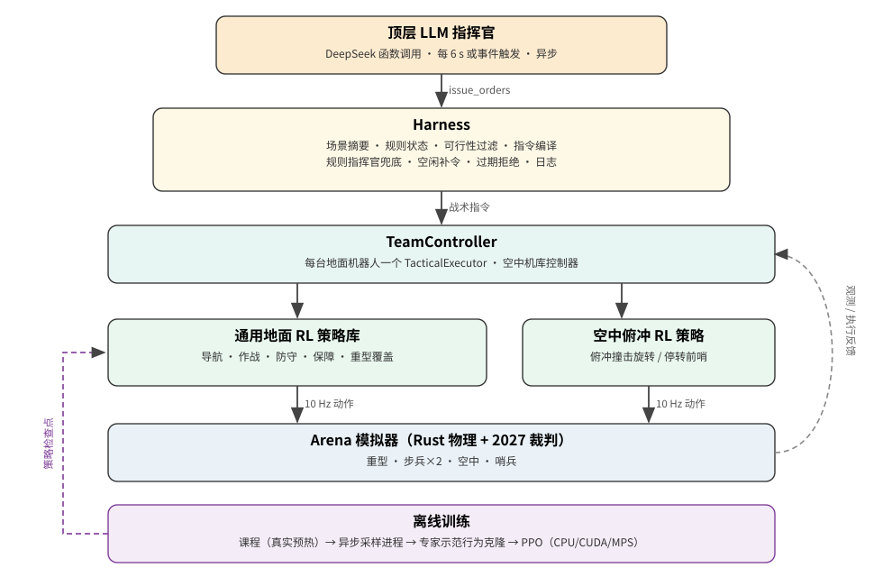
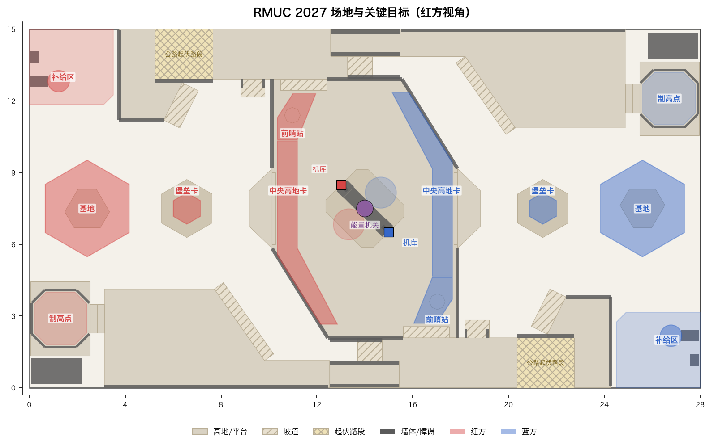
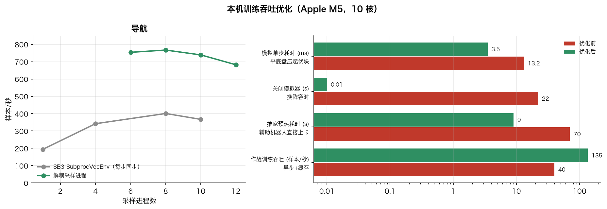
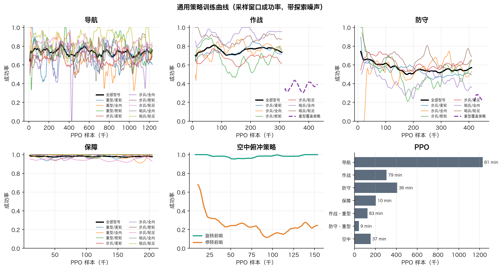
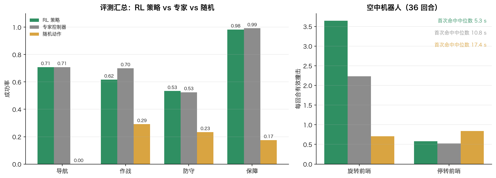
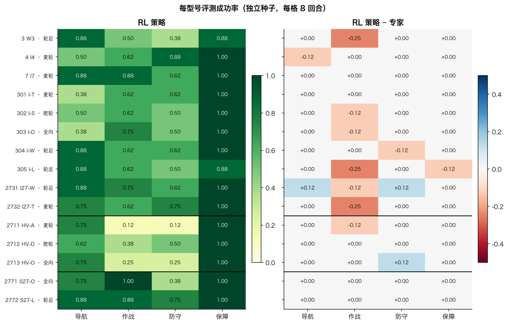
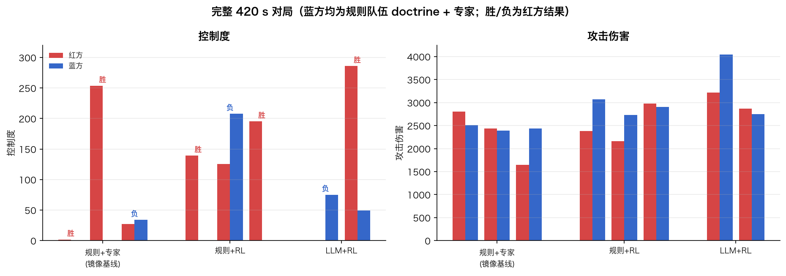
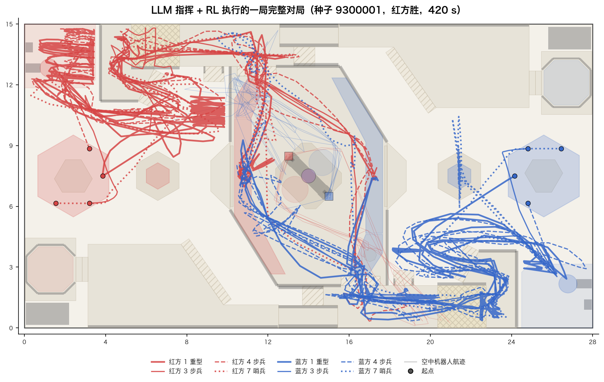
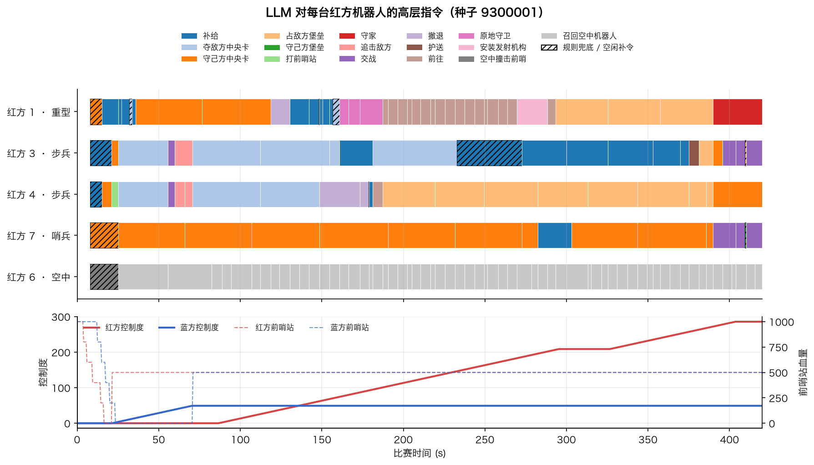

[English](../multi-robot.md) | **中文**

# 全队 LLM 指挥 + 通用 RL 执行（2027 全兵种）

本版本把单台 305 的“LLM 战术 + RL 执行”扩展为**整支 2027 队伍**：顶层 LLM 每次为每台机器人选择一个高层目标（打前哨、守家、追击敌方英雄/重型、占堡垒、推家……），Harness 负责可行性判断、规则状态和指令编译，低层由**一套对所有地面型号通用、按机器人参数条件化的 PPO 策略**按 10 Hz 执行。物理、规则和裁判全部来自原 Arena，未修改模拟器。



## 机器人覆盖

| 槽位 | 兵种 | 可选型号（2027 合规） | 底盘 | 低层执行 |
| --- | --- | --- | --- | --- |
| 1 | 重型（英雄+工程合并） | 2711 / 2712 / 2713 | 麦轮 / 舵轮 / 全向 | 通用策略；42 mm 发射机构需先解锁并在工作台安装（`install_launcher`） |
| 3、4 | 步兵 | 3、4、7、301–305、2731、2732 | 轮足 / 麦轮 / 舵轮 / 全向 | 通用策略 |
| 7 | 哨兵 | 2771 / 2772 | 全向 / 串联腿 | 通用策略（姿态由宿主按阶段切换） |
| 6 | 空中机器人系统 | 2761 / 2762 / 2763 | 机库 + 2–4 架 | 前哨撞击：学习的俯冲时机策略（每架独立）；基地撞击：显式制导；绕开中央能量机关龙门 |

一个策略覆盖 15 个地面型号。观测中包含公开设计参数（兵种、底盘、口径、尺寸、跳跃/自扶正/隧道能力、参考速度、质量、云台角速度），同一套 7 维离散动作按底盘解释：

| 动作头 | 轮足（非全向） | 麦轮/舵轮/全向 |
| --- | --- | --- |
| 移动模式 + 速度 | 沿路线/后退/侧向，先转向再平移 | 任意方向平移 |
| 俯仰/偏航残差、开火 | SDK 弹道辅助 + 学习残差 | 同左 |
| 姿态 | 腿长 低/标准/高 | 正常 / 小陀螺（yaw_rate）/ 超级电容加速 |
| 规避 | 跳跃（仅导航） | 横向交替闪避 |

旧的 305 专用策略库（`checkpoints/serial305`，含自扶正和 2026 飞坡）保持不变，旧接口与测试照常可用。

## 训练场景（真实机制，不改裁判状态）

训练场景只设置出生位姿和弹量；结构伤害、占点、开甲、发射机构安装全部由普通动作在预热中真实获得：

- **导航**：地图地标与导航节点之间的随机路线、连续三段换令（同一局内）、撤退到补给区；超时按公开栅格路线长度计算。
- **作战**：攻击前哨（可有还击守卫）、交战/追击（目标含敌方重型，逃跑或绕行，部分还击）、**推家**（助手先占敌方中央高地卡夺取前哨控制点，180 s 后另一助手占敌方堡垒卡 10 s 打开基地装甲，然后学习者射击基地）。
- **防守**：守家（1–2 名入侵者，部分开火）、守己方中央卡、夺敌方中央卡、**占敌方堡垒**（180 s 后且控制敌方前哨点时，10 s 打开基地装甲即成功）、**守己方堡垒**（敌方先夺取我方前哨点使堡垒生效）。
- **保障**：按口径补给（17 mm / 42 mm）、护送、巡逻。
- **重型**：先真实等待解锁并安装发射机构；蓝方助手占我方中央卡使控制度落后，按公开公式约 185 s 解锁（否则 300 s），随后由专家驱动转场，同一局内连续多个记录阶段以摊薄预热成本。



上图由 Arena 的 2027 地图几何直接绘制，标出训练和 LLM 指令使用的命名地点。公路起伏路段（交叉阴影）是平底盘物理计算的热点，见下一节。

## 本机（Mac）资源利用

实测与对应设计：

- **解耦、异步的采样进程**：SB3 `SubprocVecEnv` 每 10 Hz 一步全体同步，最慢的环境（路径搜索、重置、预热）拖住所有进程：1→8 进程仅 194→401 步/秒。`parallel.RolloutWorkers` 让每个进程持有一个模拟器和策略的 CPU 副本，独立采完整段 rollout（8 进程约 750 步/秒，M5 的 10 核在 6–8 进程处饱和）。作战课程里重型预热可让单个进程一段耗时 185 s，因此再改为异步流式：任一进程交回一段就立即带最新权重派发下一段，学习器取最先到达的 8 段更新；PPO 用采样时记录的行为对数概率和裁剪吸收 1–2 个版本的滞后。
- **两个训练任务并行**：即使异步，单个任务也有空闲核（进程在等 Rust 或启动）；两族同时训练能把 10 核占满，总吞吐比串行高。
- **模拟器生命周期**：换阵容时关闭旧模拟器，`Match.close` 会等待 Rust 进程退出，在负载下每次约 20 s，曾占作战训练 88% 的时间。现在每个进程按阵容缓存最多 6 个模拟器，淘汰时先结束进程再关闭。
- **预热成本**：推家/占敌方堡垒需要先真实夺取敌方中央卡、等到 180 s、再占堡垒 10 s。助手机器人直接部署在卡上（仍需裁判计时），纯等待时用粗粒度动作重复；推家预热从 70 s 墙钟降到约 9 s。重型发射机构的解锁时间用公开公式（控制度落后提前解锁）缩短到约 185 s。
- **学习器设备**：小 MLP 的 PPO 更新在 CPU 上 0.07 s，MPS 上 2.3 s（启动和小批量开销），所以 `--device auto` 在 Mac 上选 CPU；有 CUDA 时选 CUDA。采样进程始终用 CPU 推理并设单线程。
- **物理热点**：麦轮/全向/舵轮压在公路起伏块上的轮地接触计算极慢（舵轮重型单步可达 268 ms，平时约 3 ms）。路线规划让平底盘走公路无起伏的半幅（轮足保留原有的正交过坎），模拟平均步耗从 13.2 ms 降到约 3.5 ms。
- **预热加速**：纯等待阶段（计时、等解锁、卡上计时）临时把动作重复从 2 提到 20 个物理节拍，60 s 模拟耗时 2.1 s → 1.0 s。
- **专家示范 + PPO**：底盘感知的专家只保留成功回合做行为克隆，然后 PPO 微调，避免从零探索全地图。



## CUDA

```bash
uv run arena-rl train-ground --family combat --device cuda --workers auto --output runs/ground-cuda/combat
```

`--device cuda|cuda:N` 把 PPO 更新和行为克隆放到 GPU，采样仍在 CPU 进程中；自动设置 `CUBLAS_WORKSPACE_CONFIG` 并启用确定性算法（`warn_only`）。CUDA 路径未在本机验证（本机无 CUDA）。

## 命令

```bash
# 训练并评测全部四个通用策略族（导航/作战/防守/保障）
sh examples/train_ground_all.sh runs/ground-v1 8 auto
# 单族训练、按型号评测
uv run arena-rl train-ground --family navigation --steps 1228800 --workers 8 --output runs/ground/navigation
uv run arena-rl evaluate-ground --checkpoint runs/ground/navigation --episodes-per-model 12
# 某类型号表现不足时，以通用策略为起点做专门微调（目录名 <族>-<名字> 会被策略库自动作为覆盖加载）
uv run arena-rl train-ground --family combat --models 2711 2712 2713 --initialize-from checkpoints/ground/combat \
  --steps 204800 --output checkpoints/ground/combat-heavy
# 整队对局：LLM 指挥（DeepSeek，函数调用）+ RL 执行；蓝方为声明的规则队伍
uv run arena-rl team-match --policies checkpoints/ground --commander llm --matches 2 --output runs/team-llm
# 无 LLM 基线（同一 Harness，规则指挥官）
uv run arena-rl team-match --policies checkpoints/ground --commander doctrine --speed 0 --output runs/team-doctrine
# 外部 LLM 客户端通过 JSONL 指挥整队
uv run arena-rl serve-team --policies checkpoints/ground --realtime
```

## LLM Harness

- **一个严格工具**：`issue_orders(plan, orders)`，每台机器人一项 `{objective, target, place, intent}`。每台机器人的 `objective` 枚举只包含此刻可执行的目标；目标机器人 ID、命名地点同样是枚举。应用前在当前时刻再次校验。
- **场景摘要**：时间、比分（控制度/伤害/击杀）、结构 HP 与归属、控制点、规则状态（敌方基地是否受保护/是否开甲、我方是否控制敌方前哨点、敌方堡垒是否可用、我方堡垒是否生效、解锁时间）、经济、每台机器人状态与当前指令执行反馈、可行目标与被阻止目标的原因、全队视野内及近期见过的敌人、公开事件、最近几次决策及被拒原因。不暴露对方弹量、经济或策略。
- **目标**：`attack_outpost`、`push_base`、`defend_base`、`capture_enemy_central`、`hold_own_central`、`occupy_enemy_fortress`、`hold_own_fortress`、`pursue_enemy`（如追击敌方重型/英雄）、`engage_enemy`、`resupply`、`retreat`、`escort`、`patrol`、`goto`、`hold_position`、`install_launcher`；空中：`drone_strike_outpost`、`drone_strike_base`、`drone_recall`。
- **异步与容错**：推理期间机器人继续执行当前指令；超时/非法输出/过期决策会记录并由规则指挥官（doctrine）兜底；某台机器人空闲 8 s 未获指令时由 doctrine 补令；队友视野共享到每台执行器的目标记忆。
- **记录**：每局的请求场景、模型回复、应用结果、错误、延迟与 token 用量写入 `decisions-<seed>.jsonl`，原生回放可用 Arena 验证。
- **换模型**：`--model`、`--base-url`、`--api-key-env` 指向任何 OpenAI 兼容的函数调用接口（默认 DeepSeek 严格模式 beta 端点）；密钥只从环境变量读取，不进入提示词和日志。

### `serve-team` JSONL 协议（外部 LLM / Agent 客户端）

每行一个 JSON 请求，每个请求一行响应：

| 请求 | 作用 |
| --- | --- |
| `{"op":"scene"}` | 返回场景摘要和本时刻的严格 `issue_orders` 工具定义（可直接交给客户端的模型） |
| `{"op":"orders","plan":"...","orders":{...},"basis_tick":N}` | 按场景枚举校验、拒绝过期决策，然后编译执行；返回每台机器人的执行/拒绝原因 |
| `{"op":"advance","steps":k}` | 步进模式下推进 k×0.1 s；`--realtime` 时模拟在后台以 10 Hz 持续运行 |
| `{"op":"reset","seed":s}` / `{"op":"save_replay","path":...}` / `{"op":"close"}` | 重置、导出原生回放、关闭 |

启动时第一行 `ready` 包含机器人列表和推荐系统提示词。

## 结果

### 训练量（本机 Apple M5，CPU 学习器）

| 策略 | 覆盖型号 | 示范（成功回合样本） | 行为克隆整动作一致率 | PPO 样本 | 墙钟 |
| --- | --- | --- | --- | --- | --- |
| navigation | 全部 15 个地面型号 | 31,637 | 0.89 | 1,228,800 | 81 min |
| combat | 10 步兵 + 2 哨兵 | 16,842 | 0.89 | 307,200 | 79 min |
| combat-heavy（覆盖） | 3 重型 | 2,565 | 0.82 | 122,880 | 83 min |
| defense | 10 步兵 + 2 哨兵 | 52,616 | 0.94 | 409,600 | 36 min |
| defense-heavy（覆盖） | 3 重型 | 27,049 | 0.92 | 40,960 | 9 min |
| support | 全部 15 个地面型号 | 17,142 | 0.91 | 204,800 | 10 min |
| aerial | 3 种机库 | 27,573 | 0.97 | 153,600 | 37 min |

重型在混合训练中被稀释并退化（舵轮重型的随机采样成功率从 0.37 降到 0.06），因此作战/防守改为“步兵+哨兵通用策略 + 重型专用覆盖”，策略库按型号自动选择。



曲线是带探索噪声的采样窗口成功率（5 点滑动平均），不是确定性评测；评测见下文。

### 每型号评测（独立种子，每型号每种方式 8 回合，确定性动作）

“专家”是生成示范的底盘感知规则控制器，“随机”是均匀随机动作；三者使用同一批种子和同一个模拟器。评测关闭训练专用的“平底盘压起伏块即失败”规则。

| 族 | RL 策略 | 专家 | 随机 |
| --- | --- | --- | --- |
| 导航 | 0.71 | 0.71 | 0.00 |
| 作战（含重型覆盖） | 0.62 | 0.70 | 0.29 |
| 防守（含重型覆盖） | 0.53 | 0.53 | 0.23 |
| 保障 | 0.98 | 0.99 | 0.17 |



| 型号 | 底盘 | 导航 策略/专家 | 作战 策略/专家 | 防守 策略/专家 | 保障 策略/专家 |
| --- | --- | --- | --- | --- | --- |
| 3 步兵 W3 | 轮足 | 0.88 / 0.88 | 0.50 / 0.75 | 0.38 / 0.38 | 0.88 / 0.88 |
| 4 步兵 I4 | 麦轮 | 0.50 / 0.62 | 0.62 / 0.62 | 0.88 / 0.88 | 1.00 / 1.00 |
| 7 步兵 I7 | 麦轮 | 0.88 / 0.88 | 0.88 / 0.88 | 0.62 / 0.62 | 1.00 / 1.00 |
| 301 步兵 I-T | 麦轮 | 0.38 / 0.38 | 0.62 / 0.62 | 0.62 / 0.62 | 1.00 / 1.00 |
| 302 步兵 I-S | 舵轮 | 0.50 / 0.50 | 0.62 / 0.75 | 0.50 / 0.50 | 1.00 / 1.00 |
| 303 步兵 I-O | 全向 | 0.38 / 0.38 | 0.75 / 0.88 | 0.50 / 0.50 | 1.00 / 1.00 |
| 304 步兵 I-W | 轮足 | 0.88 / 0.88 | 0.62 / 0.62 | 0.62 / 0.75 | 1.00 / 1.00 |
| 305 步兵 I-L | 轮足（串联腿） | 0.88 / 0.88 | 0.62 / 0.88 | 0.50 / 0.50 | 0.88 / 1.00 |
| 2711 重型 HV-A | 麦轮 | 0.75 / 0.75 | 0.12 / 0.25 | 0.12 / 0.12 | 1.00 / 1.00 |
| 2712 重型 HV-D | 舵轮 | 0.62 / 0.62 | 0.38 / 0.38 | 0.50 / 0.50 | 1.00 / 1.00 |
| 2713 重型 HV-O | 全向 | 0.75 / 0.75 | 0.25 / 0.25 | 0.25 / 0.12 | 1.00 / 1.00 |
| 2731 步兵 I27-W | 轮足 | 0.88 / 0.75 | 0.75 / 0.88 | 0.62 / 0.50 | 1.00 / 1.00 |
| 2732 步兵 I27-T | 麦轮 | 0.75 / 0.75 | 0.62 / 0.88 | 0.75 / 0.75 | 1.00 / 1.00 |
| 2771 哨兵 S27-O | 全向 | 0.75 / 0.75 | 1.00 / 1.00 | 0.38 / 0.38 | 1.00 / 1.00 |
| 2772 哨兵 S27-L | 轮足（串联腿） | 0.88 / 0.88 | 0.88 / 0.88 | 0.75 / 0.75 | 1.00 / 1.00 |

每格只有 8 回合，单格误差约 ±0.17。作战另在 4 个型号 × 10 个相同种子上复核：行为克隆 0.70、PPO 0.70、专家 0.725，差别在噪声内。



| 空中（36 回合） | 平均有效撞击 | 平均伤害 | 有命中的回合 | 首次命中中位数 |
| --- | --- | --- | --- | --- |
| RL 策略 | **2.03** | 406 | 21 | **5.3 s** |
| 制导专家 | 1.33 | 267 | 18 | 10.8 s |
| 随机 | 0.78 | 156 | 18 | 17.4 s |

结论：

- 地面策略在 15 个型号上普遍达到生成示范的专家水平，但在当前预算下 **PPO 微调没有显著超过专家**（导航、防守、保障持平；作战在噪声范围内略低）。性能上限主要由路线规划和物理条件决定：平底盘全向/变形步兵（301/303）导航仍只有 0.38，失败多为超时和卡住。
- 空中机库的俯冲时机策略是唯一明显超过规则控制器的部分：命中次数 +52%，首次命中提前一半。停转后的前哨仍弱（0.58 次/回合）。
- 重型作战/防守成功率低（专家同样低）：42 mm 热量限制、低功率底盘和较短的订单时限使其难以在一次指令内完成；重型主要价值在发射机构安装后的后期推家。

### 全队对局

完整 420 s 的 2027 对局，双方都是默认阵容（2711 重型、2731 / 2732 步兵、2761 机库、2771 哨兵），正常经济、复活和裁判。蓝方始终是声明的规则队伍（doctrine 指挥 + 专家控制器）。三组使用同样的种子 9300000 起；原生回放全部通过 Arena 校验。

| 红方 | 对局 | 红方胜 | 红方控制度 | 红方攻击伤害 | 备注 |
| --- | --- | --- | --- | --- | --- |
| doctrine + 专家控制器（镜像基线） | 3 | 2 | 1.7 / 253.6 / 27.0 | 2805 / 2435 / 1650 | 双方结构均被空中撞击摧毁后重建 |
| doctrine + RL 执行 | 3 | 2 | 139.2 / 125.2 / 195.2 | 2380 / 2160 / 2980 | 三局重型都真实完成发射机构安装 |
| **DeepSeek LLM + RL 执行** | 2 | 1 | 0.0 / 285.8 | 3215 / 2870 | 每局 79–80 次决策，中位延迟 2.0 s（p95 2.6 s） |



LLM 对局细节：每次调用约 5.2k 提示 + 0.27k 输出 token，每局约 43 万 token；每局 2 次失败（模型输出非法 JSON 或网络超时），均由 doctrine 兜底，比赛未中断。模型的常用目标依次是夺敌方中央卡、召回空中机器人、占敌方堡垒、补给和守己方中央卡；6 次被 Harness 拒绝（如推理期间前哨已被摧毁、机器人已阵亡、`goto` 未给地点）。三组对局的报告、LLM 决策日志和降采样轨迹已存入 [`evaluations/team-matches-2026-10-19`](../../evaluations/team-matches-2026-10-19)。

样本量很小（2–3 局），只说明链路在真实整局中可用、LLM 指挥与规则指挥处于同一水平；不能据此宣称 LLM 更强。第一局 LLM 输在控制度：它把两台步兵和哨兵长期压在敌方中央卡附近，没有守住己方前哨点。

下面是 LLM 获胜的第二局（种子 9300001）。从决策日志看：红方重型前 2 分钟补给并守己方中央卡，270 s 安装发射机构后转去占敌方堡垒，最后 30 s 回防基地；两台步兵前半局争夺敌方中央卡，步兵 4 从 187 s 起一直占敌方堡垒；哨兵基本守己方中央卡；空中机器人 8 s 由 doctrine 派出撞击前哨，25 s 起一直被 LLM 召回。轨迹图中粗线为地面机器人，细线为空中机器人航迹。



时间线按 LLM 的 `issue_orders` 结果展开每台红方机器人当时生效的目标；斜线块是 doctrine 兜底或空闲补令，下方为双方控制度和前哨站血量。



所有图表都由仓库内的数据生成：`uv run --with matplotlib python examples/make_figures.py`（需要 `ARENA_ROOT` 指向 Arena 以读取地图几何）。轨迹由 `examples/extract_match_traces.py` 从原生回放降采样（每 0.5 s 一帧）。

## 限制

- 地面策略的 PPO 微调在本预算下没有显著超过专家；提升主要来自通用契约本身（一套网络覆盖 15 个型号）和工程化的训练设施。重型作战/防守成功率低。
- 空中机库的学习策略只训练了前哨撞击（转动与停转）；撞击基地沿用显式制导。重型的装配（机械臂取放能量单元）未纳入，发射机构按时间规则解锁。
- 对手是声明的规则队伍（doctrine + 专家控制器），不是自博弈或人类队伍；胜率只代表对这一对手。
- 训练中每个模拟器只有一个学习者，其余机器人为脚本；多机协同由 LLM/doctrine 在目标层完成。
